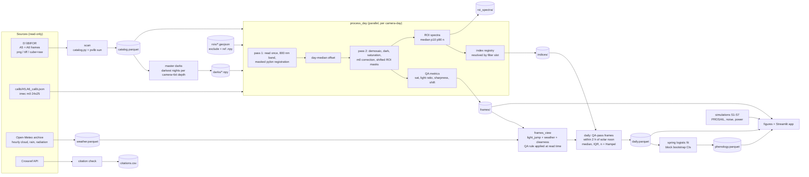
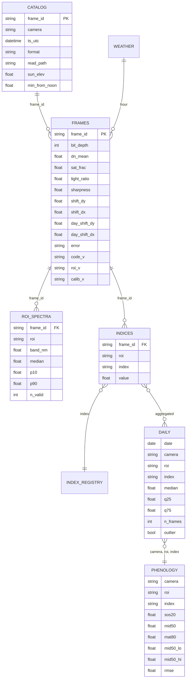
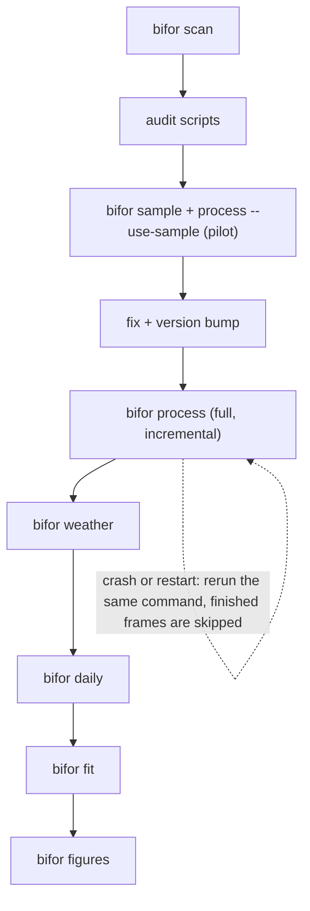

# Architecture

## Data flow

## Data model

## Stage order and resume

Every row carries `code_v`, `roi_v` and `calib_v`. Readers keep only rows that match the current config. Bumping `versions.code` in `bifor.toml` therefore reprocesses everything without deleting old outputs.
